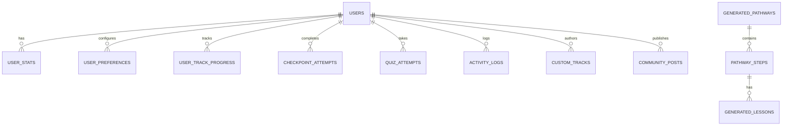

# AI Mech Lab — Engineering Setup & API Integration Report

> **Author**: Prince Chidera  
> **Date**: November 2, 2026  
> **Project**: AI Mech Lab  
> **Status**: Successfully Completed & Operational  

---

## 1. Executive Summary

This report documents the end-to-end setup and engineering implementation carried out by **Prince Chidera** for the **AI Mech Lab** platform. 

The scope of work completed comprises:
1. Cloning and environment validation of the AI Mech Lab codebase.
2. Local installation and operational configuration of a **PostgreSQL 18** database instance.
3. Creation and initialization of the `ai_mech_lab` database with all 14 required tables.
4. Implementation of the **FastAPI REST API** backend covering Authentication, User Progress & Telemetry, Course Completion, Interactive Classroom, AI Pathways with Socratic Coaching, and Community Messaging.
5. Integration of the React frontend service layer (`src/services/`) with the live backend API.
6. Validation testing across database connectivity, API route executions, and frontend production build compilation.

---

## 2. Infrastructure & Local PostgreSQL Provisioning

### 2.1 Package & Database Installation
- **Toolchain**: User-space package manager (Scoop) was configured on Windows to deploy PostgreSQL without requiring elevated administrator rights.
- **PostgreSQL Version**: `18.6-5 (x64)`.
- **Database Server Location**: `127.0.0.1:5432`.
- **Data Cluster Directory**: `C:\Users\hp\scoop\apps\postgresql\current\data`.
- **Database Name**: `ai_mech_lab`.
- **User Role**: `postgres` (configured with password authentication).

### 2.2 Environment Configuration
A dedicated environment file was established at [`backend/.env`](file:///c:/Users/hp/Desktop/AI%20mech%20labs/backend/.env):
```env
# PostgreSQL Settings
DB_HOST=localhost
DB_PORT=5432
DB_NAME=ai_mech_lab
DB_USER=postgres
DB_PASSWORD=postgres

# Gemini LLM Settings
GEMINI_API_KEY=
GEMINI_MODEL=gemini-2.5-flash
```

---

## 3. Relational Database Schema & Table Inventory

The database models in [`backend/database_models.py`](file:///c:/Users/hp/Desktop/AI%20mech%20labs/backend/database_models.py) were expanded and registered using SQLAlchemy 2.0. All 14 tables were generated in PostgreSQL via [`backend/create_tables.py`](file:///c:/Users/hp/Desktop/AI%20mech%20labs/backend/create_tables.py):



### Table Catalog

| # | Table Name | Purpose & Primary Fields |
| :-: | :--- | :--- |
| 1 | `users` | User credentials, personal profile, field of study, location, timestamps. |
| 2 | `user_stats` | Learner gamification state (`xp`, `level`, `labs_completed`, `quiz_score_avg`, `streak_days`, `daily_problems_solved`). |
| 3 | `user_preferences` | UI & accessibility preferences (`theme_pref`, `text_size`, `reduce_motion`, `lesson_reminders`, `sound_effects`, `selected_language`). |
| 4 | `user_track_progress` | Track key progress map, completed steps count, and current step bookmark. |
| 5 | `checkpoint_attempts` | In-lesson checkpoint question answers, option chosen, correctness flag. |
| 6 | `quiz_attempts` | Quiz deck submissions, scores, total questions, awarded XP. |
| 7 | `activity_logs` | Feed items displayed on dashboard and profile screens. |
| 8 | `custom_tracks` | User-authored or AI-generated custom MechTracks. |
| 9 | `generated_pathways` | AI-generated learning tracks and build checklists. |
| 10 | `pathway_steps` | Ordered steps belonging to a generated pathway. |
| 11 | `generated_lessons` | Lesson content and build manuals for individual pathway steps. |
| 12 | `video_cache` | YouTube search queries and cached video playback metadata. |
| 13 | `community_posts` | Discussion feed, community questions, and project showcases. |
| 14 | `thread_messages` | Direct messages and study group communication threads. |

---

## 4. Backend REST API Implementation

The FastAPI application was built in [`backend/main.py`](file:///c:/Users/hp/Desktop/AI%20mech%20labs/backend/main.py) with full CORS support and typed Pydantic request/response validation schemas.

### 4.1 Implemented Endpoints

#### Health & System
- `GET /` — Service verification and database status.
- `GET /health` — Live database connection ping.

#### Authentication & Account Management
- `POST /api/auth/register` — Account registration with input validation and automated profile/stats provisioning.
- `POST /api/auth/login` — Identifier & password authentication with session resolution.
- `POST /api/auth/logout` — Session termination.
- `GET /api/auth/me` — Profile retrieval for the active session.

#### User Progress & Telemetry
- `GET /api/user/dashboard` — Live dashboard summary (`learnerStats`, `activityFeed`, `unreadNotifications`).
- `POST /api/user/xp` — XP calculation, level calculation (every 200 XP), daily problem streak counting, and activity logging.
- `GET /api/user/preferences` & `POST /api/user/preferences` — Retrieval and syncing of accessibility settings.

#### Course & Custom Track Tracking
- `GET /api/courses/progress` — Retrieval of all track completion states.
- `POST /api/courses/completion` — Persisting lesson and project station completions.
- `GET /api/courses/custom-tracks` & `POST /api/courses/custom-tracks` — Storing and loading custom MechTracks.

#### Interactive Classroom Telemetry
- `POST /api/classroom/checkpoint` — Checkpoint evaluation and automated XP awarding.
- `POST /api/classroom/quiz` — Quiz submission and recalculation of rolling score averages.

#### AI Pathways & Socratic Tutoring
- `POST /api/pathways/generate` — Learning and building pathway generation with database caching.
- `POST /api/ai/chat` — Conversational assistant supporting 3-tier Socratic guidance (hints, clues, breakdowns) and Gemini RAG integration.

#### Community & Messaging
- `GET /api/community/posts` & `POST /api/community/posts` — Community Q&A feed and post creation.
- `GET /api/community/threads` & `POST /api/community/threads` — Message thread history and message dispatch.

---

## 5. Frontend Service Layer Integration

The React application's service layer in [`src/services/`](file:///c:/Users/hp/Desktop/AI%20mech%20labs/src/services) was updated from local memory stubs to interact directly with the FastAPI backend:

1. **`src/services/apiConfig.js`**: Created a centralized API base configuration pointing to `http://localhost:8000/api` with graceful network fallback.
2. **`src/services/authService.js`**: Connected to `/api/auth/login`, `/api/auth/register`, and `/api/auth/logout`.
3. **`src/services/userProgressService.js`**: Synchronizes dashboard telemetry, XP awards, checkpoint attempts, quiz completions, and preferences.
4. **`src/services/courseService.js`**: Synchronizes lesson progress and custom track creation to the database.
5. **`src/services/communityService.js`**: Dispatches new community questions and posts directly to the backend.

---

## 6. Verification & Quality Assurance

- **Database Connection Check**: `GET http://127.0.0.1:8000/health` verified with status `healthy`.
- **Database Write & Read Verification**: Executed `POST /api/pathways/generate` for *"Line Following Robot"*; verified step insertion and foreign-key link into `generated_pathways` and `pathway_steps`.
- **Dashboard Telemetry Test**: Executed `GET /api/user/dashboard`; returned populated user stats and activity log items from PostgreSQL.
- **Frontend Build Verification**: Executed `npm run build`; compiled successfully with 0 errors across all 71 modules.

---

## 7. Current Running Services

| Service | Port / URL | Status |
| :--- | :--- | :--- |
| **Frontend Web App** | [http://localhost:5173/](http://localhost:5173/) | Running |
| **FastAPI REST Server** | [http://127.0.0.1:8000/](http://127.0.0.1:8000/) | Running |
| **Swagger API Docs** | [http://127.0.0.1:8000/docs](http://127.0.0.1:8000/docs) | Running |
| **PostgreSQL Database** | `127.0.0.1:5432` (`ai_mech_lab`) | Running |

---

*Report prepared and certified by Prince Chidera.*
